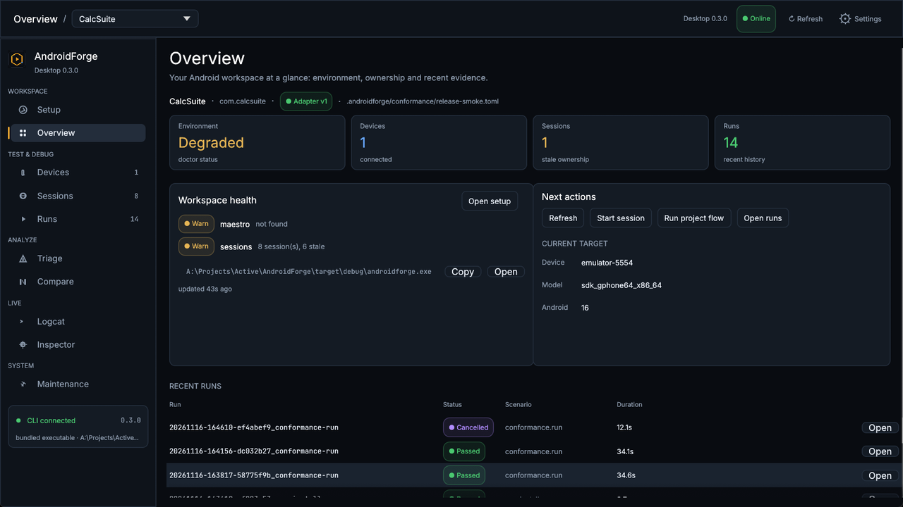

# AndroidForge

**Local-first Android testing and device orchestration for AI coding agents.**

[](https://github.com/JuggyBob/AndroidForge/actions/workflows/ci.yml)
[](LICENSE)
[](#project-status)

> **Alpha `v0.3.0`.** AndroidForge is usable today for emulator-driven development and agent
> workflows, but it is not a finished product. Windows is the tested host, and physical devices,
> Maestro, instrumentation, snapshot restore and root-only operations are not yet validated. Read
> [Project status](#project-status) before relying on it.

AndroidForge is a local-first Rust toolkit: a single native CLI for automation plus an optional native
desktop cockpit for humans. The CLI gives an AI coding agent a reliable way to acquire an Android
device, install a build, inspect and drive the UI, prepare fixture state, collect evidence and return
machine-readable results — without Android Studio, fragile coordinate scripts, a daemon or a cloud
service. The desktop app is a separate `androidforge-desktop.exe` that drives the same CLI and its JSON
contract; it never reimplements or replaces the CLI.

The same CLI binary runs every project. Project-specific behavior lives in `.androidforge/project.toml`,
fixtures, hooks, conformance manifests and scripts. The Rust core contains no app names, package ids or
project branches.

## Why this exists

Agent-driven Android testing usually fails at the same places:

- a device is already in use, or the agent cannot tell which device it owns;
- an APK installs, but nobody checks what was actually installed;
- UI taps work by coordinates until the screen changes;
- a failed assertion leaves no screenshot, hierarchy or logcat;
- a test reports success because `adb` exited 0, even though the app did nothing;
- the agent has to parse human text instead of a stable JSON contract.

AndroidForge makes those cases explicit. Sessions coordinate device ownership. Installs record
package, version, APK hash and signing certificate. UI actions use the accessibility hierarchy. Runs
produce a JSON report and checksum manifest. Failures attach evidence. Hooks can declare postconditions.
Unsupported operations say so with `E_UNSUPPORTED_OPERATION` and alternatives.

## Designed for AI agents

- **JSON on stdout, diagnostics on stderr.** No progress bars or human text mixed into machine output.
- **Stable exit codes and structured errors.** Every error includes a code, message, context,
  suggestions and artifact paths where available.
- **Bounded execution.** External processes have timeouts and process-tree cleanup. Long-lived
  operations have explicit status and stop commands.
- **Device ownership.** A session binds an owner, device, optional emulator, heartbeat and prepared
  settings. Another agent gets `E_DEVICE_BUSY` instead of silently interfering.
- **One run, one report.** `run start`/`run end`, `ANDROIDFORGE_RUN_ID` and `report show` make a
  multi-command flow inspectable after the fact.
- **Evidence by default.** Failed app/UI/conformance steps capture a screenshot, hierarchy, logcat,
  process state and relevant dumps.
- **Project context, not hidden magic.** `--project`, `--session`, `--serial`, `--run`, `--json`,
  `--trace`, `--dry-run` and `--yes` are explicit.
- **Unmodified scripts still work.** `run -- python script.py` injects the environment contract and
  joins the existing report.

If you are wiring an agent, start with [AGENT_GUIDE.md](AGENT_GUIDE.md) and
[EXIT_CODES.md](EXIT_CODES.md). The machine-readable schemas are in [schema/](schema/).

## Features

| Area | What AndroidForge provides |
| --- | --- |
| Devices | ADB discovery, `devices list/inspect/wait`, device preparation and restore |
| Emulators | AVD listing, safe port allocation, headless start, boot wait, status, stop, snapshots |
| Sessions | Claim/attach/release/stop/restart, owner guards, heartbeats, stale-session GC |
| APKs | `aapt2`/`apksigner` inspection, signature and package checks, install identity verification |
| Apps | Launch, status, force-stop, uninstall, clear data, file push/pull for debuggable builds |
| UI | Hierarchy dump/find/assert/tap/text/clear/back/scroll/settle/wait, semantic selectors |
| Evidence | Screenshots, screen recording, logcat, crashes/ANRs, dumpsys, artifact manifests |
| Diagnostics | Notifications, channels, jobs, alarms, permissions, AppOps, Doze, battery, network, time |
| Automation | Versioned fixtures, hooks with postconditions, conformance manifests, JUnit import |
| Desktop | Native egui/eframe cockpit: onboarding, overview, devices, sessions, runs, triage, comparison, live logcat, device preview/inspector, maintenance and updates |
| Analysis | Failure triage, compatible run comparison, flaky-step analysis, copyable Markdown/JSON reports |
| Storage safety | Dry-run cleanup previews, terminal-only pruning, active-session protection, stale-session GC |
| Integration | Raw ADB passthrough, external `run --` scripts, project adapters, JSON schemas |

## What is new in v0.3.0

- **First-run setup wizard** with real CLI, Android SDK, ADB, emulator and AVD checks, plus a safe device verification step.
- **Actionable diagnostics** from `doctor`, including required/optional status, blocking impact and suggested fixes.
- **Update awareness and CLI repair** from GitHub Releases, with SHA-256 verification and rollback-safe sidecar replacement.
- **Failure triage, run comparison and flaky-step analysis** with transparent matching rules and evidence links.
- **Live logcat** with local filtering, search, pause/follow, bounded buffers, crash/ANR highlighting and export.
- **Device preview and semantic inspector** with periodic screenshots, parsed hierarchy, bounds highlighting and semantic tap/type/scroll/back actions.
- **Maintenance center** with storage accounting and confirmed, terminal-only cleanup.
- **Substantially redesigned desktop UI** with a consistent design system, keyboard-friendly navigation and validated 1280×720, 1366×768 and 1920×1080 layouts.
- **Portable ZIP and per-user Windows installer**, both unsigned.

Screenshots of the released application are in [`docs/screenshots/v0.3.0/`](docs/screenshots/v0.3.0/).



## Requirements

- **Host:** Windows 10/11 is the tested host. macOS and Linux are not yet validated.
- **Rust:** `1.95` or newer with Edition 2024 support (`rust-toolchain.toml`). The desktop crate uses
  eframe 0.37 and the glow renderer; there is no WebView, browser, Node or frontend toolchain.
- **Android SDK:** platform-tools, emulator and build-tools (`aapt2`, `apksigner`).
- **Java:** a JDK usable by `apksigner` (the SDK-bundled JDK is fine).
- **Device:** an emulator or a USB-debugging Android device.

`androidforge doctor --json` reports what is missing. Missing required SDK/ADB tooling is an
environment failure; missing Maestro is a warning.

## Install

### Download a release

1. Open [Releases](https://github.com/JuggyBob/AndroidForge/releases).
2. Choose an asset and verify it with `SHA256SUMS.txt`:
   - `androidforge-desktop-windows-x86_64.zip` - portable `androidforge.exe` + `androidforge-desktop.exe`, docs and license;
   - `androidforge-windows-x86_64-setup.exe` - per-user Windows installer with both executables, Start Menu shortcut and uninstaller;
   - `androidforge-cli-windows-x86_64.zip` - standalone `androidforge.exe` for PATH/automation.
3. For the installer, run the setup executable. No administrator rights are required. The application installs under your user profile.
4. For the portable build, extract the ZIP and launch `androidforge-desktop.exe`. Keep `androidforge.exe` beside it.
5. For the CLI only, extract the CLI zip, put `androidforge.exe` on `PATH`, and run:

```powershell
androidforge --version
androidforge doctor --json
```

The desktop searches for the CLI beside itself, then a configured path, then the development build, then `PATH`. Open Settings to point at a different CLI or workspace.

Both executables follow the same `0.3.0` version line. The desktop refuses a CLI whose version or JSON schema it does not understand rather than guessing.

> **Unsigned binaries.** The release assets are intentionally unsigned. Windows SmartScreen may warn on first launch. AndroidForge does not include a code-signing certificate or claim a verified publisher identity. Verify the published SHA-256 checksums before running downloaded files.

### Build from source

```powershell
git clone https://github.com/JuggyBob/AndroidForge.git
cd AndroidForge
cargo build --workspace --release
.\target\release\androidforge.exe doctor --json
.\target\release\androidforge-desktop.exe
```

The workspace has no runtime dependency on Python, Node, .NET or PowerShell. Java is only needed by
the Android build tools.

## Quick start

```powershell
# 1. Health check.
androidforge doctor --json
androidforge devices list --json

# 2. Start an isolated emulator session. Use the same owner for cleanup.
androidforge session start --avd Pixel_8_API_35 --port 5556 --headless --owner MyAgent --prepare --json

# 3. Install and verify a build.
androidforge app install .\app\build\outputs\apk\debug\app-debug.apk --session ses-... --json

# 4. Drive the UI semantically.
androidforge ui dump --session ses-... --json
androidforge ui wait --session ses-... --text "Welcome" --timeout 20 --json
androidforge ui tap --session ses-... --text "Continue" --json
androidforge ui text "hello world" --session ses-... --class android.widget.EditText --clear --hide-keyboard --json
androidforge ui assert --session ses-... --text "Saved" --json

# 5. Keep evidence.
androidforge capture screenshot --session ses-... --json
androidforge diagnostics collect --session ses-... --package com.example.app --json

# 6. Run a project flow.
androidforge --project .\examples\CalcSuite conformance run --session ses-... --json

# 7. Stop and release. The owner label is required.
androidforge session stop --session ses-... --owner MyAgent --json
```

For a multi-step report:

```powershell
androidforge run start --session ses-... --name smoke --json
androidforge ui assert --session ses-... --text "Welcome" --json
androidforge run end --session ses-... --json
androidforge report show latest --json
```

`run end` derives `passed`/`failed` from its steps. A failed step exits non-zero; an explicit
`--status passed` is refused unless `--allow-failures` is deliberate.

## Desktop cockpit

`androidforge-desktop.exe` is an optional native companion for people who want to see and control the
same sessions, runs and evidence the CLI produces. It is built with Rust, egui/eframe and glow; there is
no WebView, JavaScript, HTML, Node or browser runtime.

The cockpit has four pages:

- **Overview** — environment health, device/session counts, recent runs and project context.
- **Devices** — serial, model, Android version, boot state, battery and current owner.
- **Sessions** — owner, heartbeat, prepared settings and validated `Release`, `Stop` and `Restart`
  actions behind explicit confirmations.
- **Runs** — report-backed run table, build identity, steps, failure details, screenshots, hierarchy,
  logs, raw files and checksum-manifest verification.

P1 actions are intentionally narrow: start an emulator, attach a device, choose and inspect an APK,
dry-run or install it, run fixtures/conformance flows/hooks, stream output and cancel a run. Cancellation
terminates the AndroidForge child process tree (never a session command) and never stops or releases the
emulator; the session reminder stays visible. Session lifecycle operations cannot be cancelled and run to
completion. A completed operation still occupies the output panel until dismissed, but no longer blocks
the next action.

The desktop is a sidecar client, not a second implementation. Every refresh and action invokes
`androidforge --json`, parses the typed envelope and shows the CLI's own error code, message,
suggestions and artifacts. Closing the desktop does not stop the CLI, an emulator or a session.

See [USER_GUIDE.md](USER_GUIDE.md#3-desktop-cockpit) for the workflow and
[ARCHITECTURE.md](ARCHITECTURE.md#desktop-cockpit) for the design.

## Configuration

A project opts into AndroidForge with `.androidforge/project.toml`:

```toml
adapter_version = 1

[project]
name = "ExampleApp"
package = "com.example.app"
debug_package = "com.example.app.debug"
expected_cert_sha256 = "AA:BB:..." # optional release certificate pin

[emulator]
avd = "Pixel_8_API_35"

[conformance]
flow = ".androidforge/conformance/release-smoke.toml"
```

Fixtures, hooks, conformance manifests and the environment contract are documented in
[PROJECT_ADAPTER.md](PROJECT_ADAPTER.md). The adapter is optional for `doctor`, `devices`, `avd` and raw
ADB; it is required for package fallbacks, fixtures, hooks and conformance.

Precedence is CLI > environment contract > project adapter > global config > defaults. `--project`
walks upward for `.androidforge/project.toml` when omitted.

## How it works

| Crate | Responsibility |
| --- | --- |
| `androidforge-cli` | Command surface, human/JSON output, exit codes |
| `androidforge-core` | Errors, config, sessions/locks, artifacts, runs, schemas |
| `androidforge-process` | Bounded process execution, UTF-8 capture, process-tree cleanup |
| `androidforge-adb` | ADB discovery, `adb devices -l` parsing, device inspection |
| `androidforge-emulator` | AVDs, ports, headless launch, boot wait, snapshots, device prep |
| `androidforge-app` | APK inspection, install diagnosis, app/package operations |
| `androidforge-ui` | UIAutomator hierarchy, selectors, semantic actions, waits |
| `androidforge-diagnostics` | Logcat, crashes/ANRs, dumpsys, screenshots, recordings, evidence |
| `androidforge-automation` | Fixtures, hooks, conformance, Maestro, instrumentation, run exec |
| `androidforge-desktop` | Native egui cockpit, CLI locator/sidecar runner, typed models, evidence viewer, P1 actions |

Reports live under `.artifacts/runs/<run-id>/` by default and contain `report.json`, `metadata.json`
and a checksummed `manifest.json`. See [ARCHITECTURE.md](ARCHITECTURE.md) and [SCHEMA.md](SCHEMA.md).

## Safety model

- Explicit session ownership; another session gets `E_DEVICE_BUSY`.
- `session stop`, `release` and `restart` require the recorded owner or an explicit `--force`.
- Destructive app/device operations require `--yes`.
- `--dry-run` previews fixtures, installs and other meaningful operations.
- APK signatures are verified; AndroidForge never signs or auto-uninstalls on mismatch.
- The desktop confirms release/stop/restart/install/fixture/conformance/hook actions and shows the
  destructive parts in plain language.
- Cancelling a desktop run walks and terminates the AndroidForge child process tree; it does not stop,
  restart or release the emulator or session. Session lifecycle operations are not cancellable.
- No cloud, telemetry, account, API key or LLM integration.
- Raw ADB is intentionally unsafe and labelled as such.

See [SECURITY.md](SECURITY.md) for the full threat model.

## Project status

**Alpha `v0.3.0`.** The CLI has been exercised against real apps on an Android 16 emulator, and the
`0.3.0` desktop was validated against a real emulator session and the CalcSuite project. Validation
covered onboarding screens, environment diagnostics, session start/restart, APK inspection and verified
install, conformance execution, cancellation/reconciliation, live logcat, device preview and semantic
hierarchy actions, run comparison and safe maintenance preview/cleanup. See
[VERIFICATION.md](VERIFICATION.md) and [case-studies/](case-studies/).

Validated:

- Windows 10/11 host, Android 16 / API 36 emulator, x86_64.
- APK install and signature/version/hash verification.
- Semantic UI navigation, text entry, scrolling, waits and assertions.
- Session ownership and multi-agent refusal behavior.
- Fixtures, hooks with postconditions, conformance flows, JUnit import.
- Screenshots, logcat, dumpsys, notifications/jobs/alarms evidence.
- Build identity inheritance from installs into later runs.
- Native desktop onboarding, triage, comparison, flaky analysis, logcat, preview/inspector, maintenance
  and controlled P1 actions, including process-tree cancellation and run reconciliation.
- Portable ZIP and per-user installer packaging; installer upgrade preserves user data outside the
  install directory.

Not yet validated:

- Physical devices and vendor ROMs (MIUI, Samsung, etc.).
- Maestro execution and instrumentation test APKs.
- Snapshot load/restore and root-only time changes.
- macOS and Linux hosts (the desktop is Windows-validated; the CLI is not validated there either).
- Very large test suites or long-duration stress runs.
- Live update download/repair against a matching published CLI release (discovery and checksum logic are
  implemented and unit-tested; the public release carrying this version is the first usable target).
- Desktop editing of project adapters/fixtures. The cockpit is an operator console, not an IDE.

Unsupported features return `E_UNSUPPORTED_OPERATION` with a reason and alternatives. A capability
that was not exercised is not claimed as verified.

## Documentation

- [AGENT_GUIDE.md](AGENT_GUIDE.md) — operating model for autonomous agents
- [USER_GUIDE.md](USER_GUIDE.md) — setup, devices, sessions, diagnostics, troubleshooting
- [ARCHITECTURE.md](ARCHITECTURE.md) — crates, data flow, locking, process and report model
- [desktop/README.md](desktop/README.md) — building and testing the native desktop cockpit
- [PROJECT_ADAPTER.md](PROJECT_ADAPTER.md) — project config, fixtures, hooks and conformance
- [SCHEMA.md](SCHEMA.md) — report, metadata, manifest and JSON shapes
- [EXIT_CODES.md](EXIT_CODES.md) — stable exit codes and error codes
- [CAPABILITIES.md](CAPABILITIES.md) — the honest capability matrix
- [GLOSSARY.md](GLOSSARY.md) — terms used across the docs
- [VERIFICATION.md](VERIFICATION.md) — exactly what was run, including limitations
- [ACCEPTANCE.md](ACCEPTANCE.md) and [PORTFOLIO.md](PORTFOLIO.md) — acceptance flows and app coverage
- [CHANGELOG.md](CHANGELOG.md) — release history
- [SECURITY.md](SECURITY.md) — trust boundaries and private reporting

## Development

```powershell
cargo fmt --all -- --check
cargo clippy --workspace --all-targets --all-features -- -D warnings
cargo test --workspace
cargo build --workspace --release
```

Run the desktop in development with `cargo run -p androidforge-desktop`. It discovers the workspace CLI
debug build first, so no extra configuration is needed. CI runs formatting, clippy, tests and a release
build for both executables on Windows. See [CONTRIBUTING.md](CONTRIBUTING.md) for branch naming, PR
expectations and design rules.

## Contributing

Bug reports, focused pull requests and real-app reproductions are welcome. Read
[CONTRIBUTING.md](CONTRIBUTING.md) first. For security issues, use the private reporting path in
[SECURITY.md](SECURITY.md), not a public issue.

## License

MIT. See [LICENSE](LICENSE).

Copyright (c) 2026 JuggyBob.
