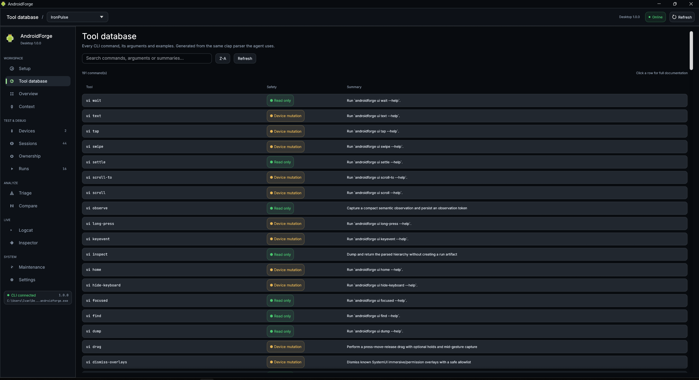
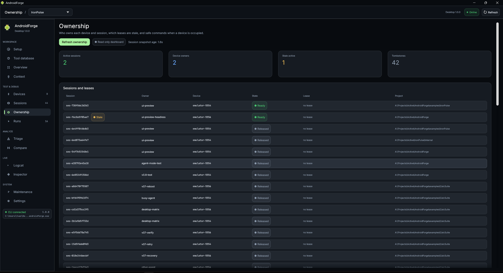
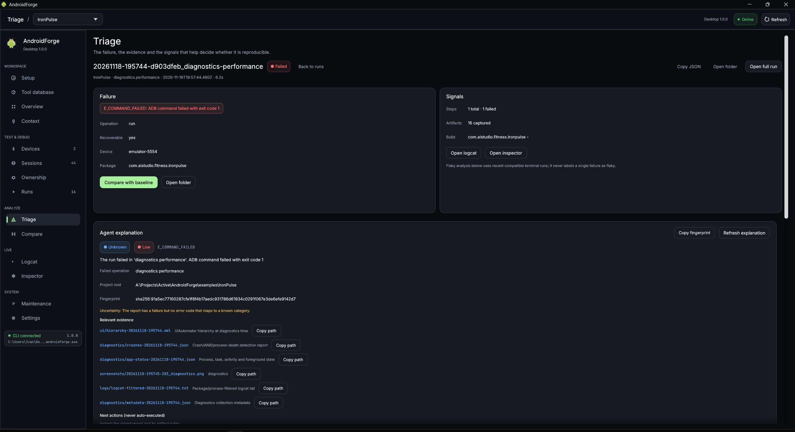

# AndroidForge

**Local-first Android testing and device orchestration for AI coding agents.**

[](https://github.com/JuggyBob/AndroidForge/actions/workflows/ci.yml)
[](LICENSE)
[](#project-status)

> **Stable `v1.1.0`.** AndroidForge is usable today for emulator-driven development and agent
> workflows. Windows is the tested host; physical-device Maestro flows, instrumentation, snapshot
> restore and root-only operations are not yet fully validated. Read [Project status](#project-status)
> and the [v1.1.0 release notes](docs/release-notes/v1.1.0.md) before relying on it.

AndroidForge is a local-first Rust toolkit: a single native CLI for automation plus an optional native
desktop cockpit for humans. The CLI gives an AI coding agent a reliable way to acquire an Android
device, install a build, inspect and drive the UI, prepare fixture state, collect evidence and return
machine-readable results — without Android Studio, fragile coordinate scripts, a daemon or a cloud
service. The desktop app is a separate `androidforge-desktop.exe` that drives the same CLI and its JSON
contract; it never reimplements or replaces the CLI.

The same CLI binary runs every project. Project-specific behavior lives in `.androidforge/project.toml`,
fixtures, hooks, conformance manifests and scripts. The Rust core contains no app names, package ids or
project branches.



## Why this exists

Agent-driven Android testing usually fails at the same places:

- a device is already in use, or the agent cannot tell which device it owns;
- an APK installs, but nobody checks what was actually installed;
- UI taps work by coordinates until the screen changes;
- a failed assertion leaves no screenshot, hierarchy or logcat;
- a test reports success because `adb` exited 0, even though the app did nothing;
- the agent has to parse human text instead of a stable JSON contract.

AndroidForge makes those cases explicit. Sessions coordinate device ownership. Installs record
package, version, APK hash and signing certificate. UI actions use the accessibility hierarchy. Runs
produce a JSON report and checksum manifest. Failures attach evidence. Hooks can declare postconditions.
Unsupported operations say so with `E_UNSUPPORTED_OPERATION` and alternatives.

## Designed for AI agents

- **JSON on stdout, diagnostics on stderr.** No progress bars or human text mixed into machine output.
- **Stable exit codes and structured errors.** Every error includes a code, message, context,
  suggestions and artifact paths where available.
- **Bounded execution.** External processes have timeouts and process-tree cleanup. Long-lived
  operations have explicit status and stop commands.
- **Device ownership.** A session binds an owner, device, optional emulator, heartbeat and prepared
  settings. Another agent gets `E_DEVICE_BUSY` instead of silently interfering.
- **One run, one report.** `run start`/`run end`, `ANDROIDFORGE_RUN_ID` and `report show` make a
  multi-command flow inspectable after the fact.
- **Evidence by default.** Failed app/UI/conformance steps capture a screenshot, hierarchy, logcat,
  process state and relevant dumps.
- **Project context, not hidden magic.** `--project`, `--session`, `--serial`, `--run`, `--json`,
  `--trace`, `--dry-run` and `--yes` are explicit.
- **Unmodified scripts still work.** `run -- python script.py` injects the environment contract and
  joins the existing report.

If you are wiring an agent, start with [AGENT_GUIDE.md](AGENT_GUIDE.md) and
[EXIT_CODES.md](EXIT_CODES.md). The machine-readable schemas are in [schema/](schema/).

## Features

| Area | What AndroidForge provides |
| --- | --- |
| Devices | ADB discovery, `devices list/inspect/wait/health`, wireless pair/connect/disconnect, preparation and restore, scoped `devices shell --read-only`, gated `devices input tap`, host tags and `ports list` |
| Emulators | AVD listing/images/creation, safe port allocation, headless start, boot wait, status, stop, snapshots, `doctor --capacity` |
| Sessions | Claim/attach/release/stop/restart, owner guards, heartbeats, stale-session GC, `list --mine --active` classification and safe dry-run reclaim |
| APKs | `aapt2`/`apksigner` inspection, signature and package checks, split APK/`.apks` identity and install verification |
| Apps | Launch, status with live version/hash expectations, force-stop, uninstall, clear data, file push/pull and verified app-data export/import/reset/seed for debuggable builds |
| Build | Explicit argv-array `build` variants, bounded/redacted logs, APK identity verification, `--install`/`--launch`/`--cold`, dry-run |
| Scenarios | JSON/TOML scenario files, audited step mapping, `--repeat`, per-step policy, pass rate and duration variance |
| UI | Hierarchy dump/find/assert/tap/text/clear/back/scroll/settle/wait, bounds/`assert-bounds`, `--for-bounds-stable`, `ui audit a11y`, `ui observe --semantics`, configurable long-press and drag holds, mid-gesture captures, stable refs |
| Evidence | Screenshots with named baseline/region comparison, `capture launch` first-frame analysis, `capture contrast`, before/after tap captures, screen recording, logcat, crashes/ANRs, dumpsys, artifact manifests |
| Diagnostics | Notifications, channels, jobs, alarms, permissions, AppOps, Doze, battery, network, reverse mappings and local HTTP/TLS mocks, time, startup/jank/memory/CPU evidence, frame percentiles and launch recording |
| Evidence security | `artifacts scan-secrets`, opt-in logcat prefix redaction, forced bundle secret refusal, binary-media disclosure |
| Automation | Versioned fixtures with declarative state, hooks with postconditions, conformance manifests, JSON/TOML scenarios, network mock scenarios, JUnit import |
| Agent context | `context`, `agent brief`, compact observations/diffs, stable refs, action receipts, postconditions and exact next-action argv |
| Diagnosis | Deterministic failure categories, confidence, evidence, stable fingerprints, recurrence memory, `report explain/history/recurrences` and diagnostic bundles |
| Orchestration | Idempotent and waitable `session ensure`, read-only `doctor fix --plan`, transparent `agent test`, APK resolution, `--only-if-changed` and parallel `agent matrix` |
| Desktop | Native egui/eframe cockpit: onboarding, context, matrix, ownership, devices with health/wireless, sessions, runs, triage with explanations/receipts/recurrence/bundle previews, comparison, live logcat, inspector, searchable tool database, repair planning, maintenance and updates |
| Analysis | Failure triage, compatible run comparison, flaky-step analysis, copyable Markdown/JSON reports |
| Storage safety | Dry-run cleanup previews, terminal-only pruning, active-session protection, stale-session GC |
| Integration | Raw ADB passthrough, external `run --` scripts, project adapters, JSON schemas, optional pinned Maestro installer |
| Agent output | `full`, `compact` and `brief` JSON profiles, `--jsonl` streaming, `--fields` result trimming, `--stats` byte/token counts, env/config defaults, minification, explicit caps/counts, one-line summaries and short next commands |

## Screenshots

Real captures from the **v1.0.0** native desktop cockpit. This five-image gallery replaces the older
v0.11.0 gallery. The Tool database capture is shown at the top of this README; Ownership and Failure
triage are shown below. Setup and Overview also exist in the gallery but show the
environment-validation state visible when they were captured. See
[docs/screenshots/v1.0.0/README.md](docs/screenshots/v1.0.0/README.md) for all five images and notes.





## What is new in v1.1.0

**Verification primitives and safer agent evidence.** v1.1.0 is an additive release: the envelope
and report schema stay at `1`, existing commands keep their behaviour, and the `device` alias for
`devices` is retained.

Closes #1, #2, #3, #4.

- **Build and install in one audited command:** `build` runs an explicit argv-array build config,
  bounds and redacts logs, verifies the produced APK identity, and can `--install`, `--launch`, or
  `--cold` launch through the fixed force-stop path. `--dry-run` executes nothing.
- **Frame, launch and layout evidence:** `diagnostics frames` (jank percentiles, missed vsync and a
  stored-baseline regression gate), `capture launch` (first app frame, splash colours), `ui bounds` /
  `ui assert-bounds`, `ui wait --for-bounds-stable`, `capture assert-color`, `capture contrast`,
  `ui audit a11y` and named `capture baseline save/update/compare`.
- **Deterministic test state:** declarative fixture `prefs`/`history`/`installed_version` state with
  explicit data consent, network mock scenarios (`newer-release`, `offline`, `bad-digest`, `no-APK`),
  device night/locale/font/network scenarios, AVD `images`/`create`, `doctor --capacity`, `ports list`
  and host device tags.
- **Scenario files and flake reporting:** `scenario run/validate` accepts JSON or TOML, maps steps to
  audited operations, supports `--repeat`, per-step error policy, pass rate and duration variance.
  YAML is intentionally not supported.
- **Safety and supply chain:** `artifacts scan-secrets`, `diagnostics logcat --redact-patterns`,
  `report bundle --redact-secrets` (refuses to write an unredacted bundle), scoped physical
  capability flags, `devices shell --read-only` with allow/deny prefixes, and gated `devices input tap`.
- **Reporting and agent output:** run tags/metadata, `--session`/`--tag`/`--since` selectors, report
  budgets, retention `--keep-tag`, scoped `app data export`, `--jsonl`/`--fields`/`--stats`, and
  `ui observe --semantics` with Compose `testTag`/`test-tag` selectors.
- **Measured surface:** 219 catalog commands, 221 MCP tools and 38/38 schemas in the 1.1.0 build.
  The host gate, packaged-binary hashes and physical-device campaigns are recorded in
  [VERIFICATION.md](VERIFICATION.md) and the [v1.1.0 release notes](docs/release-notes/v1.1.0.md).

## What is new in v1.0.0

**The first 1.0 stable release.** v1.0.0 closes the pre-1.0 safety and contract gaps with explicit
breaking changes, JSON fixture manifests, stronger redaction, the official Android robot icon with
third-party notices, and a reproducible release-validation gate. The host gate, packaging inspection
and two-ROM scope are recorded in [VERIFICATION.md](VERIFICATION.md): POCO X4 GT covered the approved
in-place upgrade and UI work, while REDMAGIC 10 Pro / Android 16 covered zero-touch read-only checks.
REDMAGIC UI automation and device actions are **NOT RUN**. Final asset hashes are listed in the
[v1.0.0 release notes](docs/release-notes/v1.0.0.md).

- **Breaking changes:** `notifications clear` now needs an explicit selector; more MCP tools require
  `confirm=true`; `snapshot save`/`standby set` are reclassified `device-mutation`; physical-device
  mutation is guarded; `emulator status` rejects non-emulator serials; `finalize_pass` fails a
  `Running` step; the conformance schema uses a strict `oneOf`; `--run` warns when no step is appended;
  and generated MCP tools forward `--yes`. Envelope and report schema stay at `1`.
- **Fixtures and redaction:** JSON fixture manifests (`fixture.json`/`*.json`) load beside TOML;
  JSON-style key/value secrets and mock-server query strings are redacted.
- **Attribution and notices:** the official robot icon and bundled font licenses ship with the
  installer and portable ZIP; see [THIRD_PARTY_NOTICES.md](THIRD_PARTY_NOTICES.md).
- **Release validation:** CI/release checks now fail on version drift, catalog/schema count drift and
  missing release content. Assets remain unsigned; verify `SHA256SUMS.txt`.

For older releases, see [docs/release-notes/](docs/release-notes/).

## Requirements

- **Host:** Windows 10/11 is the tested host. macOS and Linux are not yet validated.
- **Rust:** `1.95` or newer with Edition 2024 support (`rust-toolchain.toml`). The desktop crate uses
  eframe 0.37 and the glow renderer; there is no WebView, browser, Node or frontend toolchain.
- **Android SDK:** platform-tools, emulator and build-tools (`aapt2`, `apksigner`).
- **Java:** a JDK usable by `apksigner` (the SDK-bundled JDK is fine).
- **Device:** an emulator or a USB-debugging Android device.

`androidforge doctor --json` reports what is missing. Missing required SDK/ADB tooling is an
environment failure; missing Maestro is a warning.

## Install

### Download a release

1. Open [Releases](https://github.com/JuggyBob/AndroidForge/releases) or the current [v1.1.0 release](https://github.com/JuggyBob/AndroidForge/releases/tag/v1.1.0).
2. Choose an asset and verify it with `SHA256SUMS.txt`:
   - `androidforge-desktop-windows-x86_64.zip` - portable `androidforge.exe` + `androidforge-desktop.exe`, docs and license;
   - `androidforge-windows-x86_64-setup.exe` - per-user Windows installer with both executables, Start Menu shortcut and uninstaller;
   - `androidforge-cli-windows-x86_64.zip` - standalone `androidforge.exe` for PATH/automation;
   - `androidforge.exe` - standalone CLI executable, byte-identical to the copy in the ZIPs and installer;
   - `androidforge-desktop.exe` - standalone desktop cockpit executable, byte-identical to the packaged copy.
3. For the installer, run the setup executable. No administrator rights are required. The application installs under your user profile.
4. For the portable build, extract the ZIP and launch `androidforge-desktop.exe`. Keep `androidforge.exe` beside it.
5. For the CLI only, extract the CLI zip, put `androidforge.exe` on `PATH`, and run:

```powershell
androidforge --version
androidforge doctor --json
```

The two standalone EXEs are the exact binaries bundled in the ZIPs and installer. Keep
`androidforge.exe` beside `androidforge-desktop.exe` when using the standalone files; the desktop
cockpit requires that adjacency. The desktop searches for the CLI beside itself, then a configured path,
then the development build, then `PATH`. Open Settings to point at a different CLI or workspace.

Both executables follow the same `1.1.0` version line. The desktop requires an exact CLI version match and refuses a CLI whose version or JSON schema it does not understand rather than guessing.

> **Unsigned binaries.** The release assets are intentionally unsigned. Windows SmartScreen may warn on first launch. AndroidForge does not include a code-signing certificate or claim a verified publisher identity. Verify the published SHA-256 checksums before running downloaded files.

### Build from source

```powershell
git clone https://github.com/JuggyBob/AndroidForge.git
cd AndroidForge
cargo build --workspace --release
.\target\release\androidforge.exe doctor --json
.\target\release\androidforge-desktop.exe
```

The workspace has no runtime dependency on Python, Node, .NET or PowerShell. Java is only needed by
the Android build tools.

## Quick start

```powershell
# 1. Health check.
androidforge doctor --json
androidforge devices list --json

# 2. Start an isolated emulator session. Use the same owner for cleanup.
androidforge session start --avd Pixel_8_API_35 --port 5556 --headless --owner MyAgent --prepare --json

# 3. Install and verify a build.
androidforge app install .\app\build\outputs\apk\debug\app-debug.apk --session ses-... --json

# 4. Drive the UI semantically.
androidforge ui dump --session ses-... --json
androidforge ui wait --session ses-... --text "Welcome" --timeout 20 --json
androidforge ui tap --session ses-... --text "Continue" --json
androidforge ui text "hello world" --session ses-... --class android.widget.EditText --clear --hide-keyboard --json
androidforge ui assert --session ses-... --text "Saved" --json

# 5. Keep evidence.
androidforge capture screenshot --session ses-... --json
androidforge diagnostics collect --session ses-... --package com.example.app --json

# 6. Run a project flow.
androidforge --project .\examples\CalcSuite conformance run --session ses-... --json

# 7. Stop and release. The owner label is required.
androidforge session stop --session ses-... --owner MyAgent --json
```

### Agent loop quick start (v0.10.0)

```powershell
# One snapshot instead of several discovery commands.
androidforge context --project . --json

# Acquire or reuse one owned session, idempotently.
androidforge session ensure --project . --avd Pixel_8_API_35 --owner MyAgent --ttl 1h --json

# Observe compact semantics and keep the token.
androidforge ui observe --session ses-... --json

# Act, verify and explain the effect in one command. The tap happens once.
androidforge ui tap --session ses-... --text "Settings" --wait-for-text "Preferences" --receipt --json

# Name the semantic change since the token.
androidforge ui observe --session ses-... --since obs-... --json
androidforge ui diff --session ses-... --from obs-... --json

# Explain a failure, see whether it is new/recurring/regressed, and build evidence.
androidforge report explain latest-failure --json
androidforge report recurrences --project . --json
androidforge report bundle latest-failure --output .\\evidence.zip --json

# Use a stable element reference, then run a device matrix.
androidforge ui observe --session ses-... --json
androidforge ui tap --session ses-... --ref el-... --expect-token obs-... --json
androidforge ui text "hello" --session ses-... --ref el-... --expect-token obs-... --json
androidforge ui wait --session ses-... --ref el-... --expect-token obs-... --timeout 5s --json
androidforge agent matrix --avd Pixel_8_API_35 --avd Pixel_8_API_36 --flow conformance --json

# Resolve an existing APK without running Gradle, then install only if it changed.
androidforge apk resolve --variant debug --json
androidforge app install build\\app-debug.apk --only-if-changed --json

# Use short aliases and a compact result.
androidforge ui o --session ses-... --compact --json
androidforge ui t --session ses-... --ref el-... --token obs-... --json
androidforge app install build\\outputs\\bundle.apks --only-if-changed --session ses-... --json
androidforge app install build\\base.apk --split build\\config.arm64_v8a.apk --session ses-... --json

# Measure explicit cold-start, jank, memory and CPU evidence.
androidforge diagnostics performance com.example.app --cold --settle 2s --session ses-... --json

# Plan repairs without changing the environment.
androidforge doctor fix --plan --json

# Compose the same primitives transparently, or preview them first.
androidforge --project . agent test --apk .\app-debug.apk --flow conformance --install --json
androidforge --project . agent test --apk .\app-debug.apk --flow conformance --dry-run --json
```

For a multi-step report:

```powershell
androidforge run start --session ses-... --name smoke --json
androidforge ui assert --session ses-... --text "Welcome" --json
androidforge run end --session ses-... --json
androidforge report show latest --json
```

`run end` derives `passed`/`failed` from its steps. A failed step exits non-zero; an explicit
`--status passed` is refused unless `--allow-failures` is deliberate.

## Desktop cockpit

`androidforge-desktop.exe` is an optional native companion for people who want to see and control the
same sessions, runs and evidence the CLI produces. It is built with Rust, egui/eframe and glow; there is
no WebView, JavaScript, HTML, Node or browser runtime.

The cockpit has fourteen pages:

- **Setup** - seven setup checks plus the final **Agent Handoff** prompt.
- **Overview** - environment health, device/session counts, next actions and recent runs.
- **Context** - one read-only project/session/device/app/screen/last-run snapshot.
- **Devices** - serial, model, Android version, boot state, battery, ownership and wireless ADB.
- **Sessions** - owner, heartbeat, prepared settings and validated `Release`, `Stop` and `Restart`
  actions behind explicit confirmations.
- **Ownership** - sessions and leases, device owners, stale state and safe alternatives.
- **Runs** - report-backed run table, build identity, steps, failure details, screenshots, hierarchy,
  logs, raw files and checksum-manifest verification.
- **Triage** - deterministic failure explanation, recurrence evidence and diagnostic bundles.
- **Compare** - compatible run comparison and build/environment differences.
- **Matrix** - sequential or parallel per-device conformance runs.
- **Logcat** - bounded live streaming with package/level/search filters and Follow latest.
- **Inspector** - device preview, recursive semantic hierarchy cards and node actions.
- **Maintenance** - managed paths, cleanup preview, session/run pruning and largest-run review.
- **Settings** - connection, theme, accent, fonts, updates and about.

Settings, setup and typography are now pages rather than separate windows. The final setup page provides
a copyable agent prompt with the full documentation paths and the recommended command loop.

P1 actions are intentionally narrow: start an emulator, attach a device, choose and inspect an APK,
dry-run or install it, run fixtures/conformance flows/hooks, stream output and cancel a run. Cancellation
terminates the AndroidForge child process tree (never a session command) and never stops or releases the
emulator; the session reminder stays visible. Session lifecycle operations cannot be cancelled and run to
completion. A completed operation still occupies the output panel until dismissed, but no longer blocks
the next action.

The desktop is a sidecar client, not a second implementation. Every refresh and action invokes
`androidforge --json`, parses the typed envelope and shows the CLI's own error code, message,
suggestions and artifacts. Closing the desktop does not stop the CLI, an emulator or a session.

See [USER_GUIDE.md](USER_GUIDE.md#3-desktop-cockpit) for the workflow and
[ARCHITECTURE.md](ARCHITECTURE.md#desktop-cockpit) for the design.

## Configuration

A project opts into AndroidForge with `.androidforge/project.toml`:

```toml
adapter_version = 1

[project]
name = "ExampleApp"
package = "com.example.app"
debug_package = "com.example.app.debug"
expected_cert_sha256 = "AA:BB:..." # optional release certificate pin
default_avd = "Pixel_8_API_35"

[conformance]
flow = ".androidforge/conformance/release-smoke.toml"

[build.variants]
debug = ["app/build/outputs/apk/debug/*.apk"]

[agent]
profile = "compact"
max_items = 40
max_text_chars = 240
```

Fixtures, hooks, conformance manifests and the environment contract are documented in
[PROJECT_ADAPTER.md](PROJECT_ADAPTER.md). The adapter is optional for `doctor`, `devices`, `avd` and raw
ADB; it is required for package fallbacks, fixtures, hooks and conformance.

Precedence is CLI > environment contract > project adapter > global config > defaults. `--project`
walks upward for `.androidforge/project.toml` when omitted.

## How it works

| Crate | Responsibility |
| --- | --- |
| `androidforge-cli` | Command surface, human/JSON output, exit codes |
| `androidforge-core` | Errors, config, sessions/locks, artifacts, runs, schemas |
| `androidforge-process` | Bounded process execution, UTF-8 capture, process-tree cleanup |
| `androidforge-adb` | ADB discovery, `adb devices -l` parsing, device inspection |
| `androidforge-emulator` | AVDs, ports, headless launch, boot wait, snapshots, device prep |
| `androidforge-app` | APK inspection, install diagnosis, app/package operations |
| `androidforge-ui` | UIAutomator hierarchy, selectors, semantic actions, waits |
| `androidforge-diagnostics` | Logcat, crashes/ANRs, dumpsys, screenshots, recordings, evidence |
| `androidforge-automation` | Fixtures, hooks, conformance, Maestro, instrumentation, run exec |
| `androidforge-desktop` | Native egui cockpit, CLI locator/sidecar runner, typed models, evidence viewer, P1 actions |

Reports live under `.artifacts/runs/<run-id>/` by default and contain `report.json`, `metadata.json`
and a checksummed `manifest.json`. See [ARCHITECTURE.md](ARCHITECTURE.md) and [SCHEMA.md](SCHEMA.md).

## Safety model

- Explicit session ownership; another session gets `E_DEVICE_BUSY`.
- `session stop`, `release` and `restart` require the recorded owner or an explicit `--force`.
- Destructive app/device operations require `--yes`.
- `--dry-run` previews fixtures, installs and other meaningful operations.
- APK signatures are verified; AndroidForge never signs or auto-uninstalls on mismatch.
- The desktop confirms release/stop/restart/install/fixture/conformance/hook actions and shows the
  destructive parts in plain language.
- Cancelling a desktop run walks and terminates the AndroidForge child process tree; it does not stop,
  restart or release the emulator or session. Session lifecycle operations are not cancellable.
- No cloud, telemetry, account, API key or LLM integration.
- Raw ADB is intentionally unsafe and labelled as such.

See [SECURITY.md](SECURITY.md) for the full threat model.

## Project status

**`v1.1.0` — release gate complete for the supported scope.** The full-workspace gate passed:
`cargo fmt --all -- --check` clean, strict workspace clippy clean, `cargo test --locked --workspace`
784 passed / 0 failed across 29 suites, and `cargo deny check advisories bans licenses sources`
passed (advisories/bans/licenses/sources ok; duplicate and advisory-not-detected warnings only).
Two final safety fixes — physical `diagnostics performance` now requires `Risk::AppControl`, and the
command is catalog/MCP `device-mutation` with MCP `confirm=true` unless `dry_run=true` — were followed
by a post-fix CLI gate of **375 passed / 0 failed** (bin 244, cli 91, frames 3, safety 22, schema 15),
clean CLI clippy and passing cargo-deny. The 1.1.0 build exposes 219 catalog commands, 221 MCP tools
and 38/38 schemas, and the CLI reports `androidforge 1.1.0`.

On the user-approved POCO X4 GT / Android 14 (API 34), a delegated read-only campaign passed 12/12
steps with no mutations and no NOT RUN (CalcSuite 3.1.0 foreground, bounds/`assert-bounds`, a11y
audit; session released and artifacts cleaned), and a delegated approved mutation campaign passed
`app launch --force-stop --allow-physical-app-control`, `devices input tap --allow-physical-input` and
`ui back --allow-physical-input` with its session released. Packaged assets were verified: CLI ZIP
`92bf048f0d0e022fbb947ba351314c5ff98ade4d45cc9d1a4b177133f8225a0b`, desktop ZIP
`7a8d2325aa416f701fbf27fc42cb3f926889a63359153a6c7174acf6a4157c90`, installer
`71dc973b084349d5c5676e96d3ca62971d566a166459bf3f627d287cc3b9ca5e` (`FileVersion` /
`ProductVersion` 1.1.0), CLI EXE `6e49c9f995c35a2b5968fc2b5615677179b532663d590166b54742c5de852aa4`
and desktop EXE `977cf28495aacb14f381af747c96add619ad9ae8147f707365e4ab4f227d24ad`, all matching
`dist/SHA256SUMS.txt`; the Scoop hash tracks the desktop ZIP.

**NOT RUN:** physical `diagnostics performance` (not approved), the device night-mode scenario (not
approved), silent install/uninstall (installed Desktop release directory untouched), standalone
`run repeat --count`, cross-device geometry/colour comparison and a v1.1.0 screenshot gallery. See
[VERIFICATION.md](VERIFICATION.md) and the [v1.1.0 release notes](docs/release-notes/v1.1.0.md).

**Historical v1.0.0 campaign evidence (not v1.1.0 validation).** The v1.0.0 host gate passed with
fmt and strict clippy clean, `cargo test --workspace --locked` 392 passed / 0 failed across 27 suites
(including 4 new unreadable-lock tests), clean `cargo deny` and release build; CLI and desktop both
reported `1.0.0`, with 191 catalog commands, 192 MCP tools and 31/31 schemas. The final v1.0.0
package passed checksum, installer metadata, bundled notices/fonts and silent install/uninstall
verification. On the approved POCO X4 GT / HyperOS 2 / Android 14 (API 34) device, the packaged CLI
completed an in-place IronPulse 5.1.0 → 5.1.2 upgrade (`content_different`, same certificate, data
preserved) with passing live verification, UI observation and evidence capture. On REDMAGIC 10 Pro /
RedMagicOS 11.0.6_EU / Android 16 (API 36), the same CLI passed 8/8 zero-touch read-only checks with
identical before/after package, settings and `getprop`/`df` state; no session was created. REDMAGIC
UI automation and all device actions were **NOT RUN** by the zero-touch rule. Final v1.0.0 asset
hashes are recorded in the [v1.0.0 release notes](docs/release-notes/v1.0.0.md).

Earlier releases remain in the history
below: v0.12.0 closes the IronPulse 5.1.2 truth and automation gaps: live install metadata,
byte-truthful `--only-if-changed`, verification commands, configurable gestures and waits, app-data
fixtures, adb reverse and local mock networking, visual regression, tap evidence and session-hygiene
filters. The v0.11.0 desktop cockpit and agent-onboarding work remains in place, as do the v0.10.0
agent surfaces and v0.9.x safety fixes. See [VERIFICATION.md](VERIFICATION.md),
[docs/REAL_DEVICE_COMPATIBILITY.md](docs/REAL_DEVICE_COMPATIBILITY.md),
[docs/LONG_HORIZON_TESTING.md](docs/LONG_HORIZON_TESTING.md) and [case-studies/](case-studies/).

Validated:

- v0.12.0 verification: 347 workspace tests, strict clippy/fmt, live install refresh after an
  out-of-band `adb install -r`, same-version/different-byte install under `--only-if-changed`,
  `verify-installed`/status expectations, long-press/drag/mid-capture, text-absence/idle/stability
  waits, app-data export/seed/import/reset, adb reverse, mock HTTP/TLS, visual comparison, tap
  before/after captures and session-hygiene filters on a disposable emulator.
- v0.11.0 desktop beta validation: 14/14 page smoke with seeded data, Settings brightness and
  font catalog, row-card consistency, topbar Refresh accessibility and hover, CLI-card path clipping
  and persistent console launch, light-mode sidebar readability, Setup Agent Handoff clipboard prompt
  and animations, and live recursive Inspector cards (including an isolated emulator cleanup).
- Windows 10/11 host, Android 16 / API 36 emulator, x86_64.
- APK install and signature/version/hash verification.
- Semantic UI navigation, text entry, scrolling, waits and assertions.
- Session ownership and multi-agent refusal behavior.
- Fixtures, hooks with postconditions, conformance flows, JUnit import.
- Screenshots, logcat, dumpsys, notifications/jobs/alarms evidence.
- Build identity inheritance from installs into later runs.
- Native desktop onboarding, triage, comparison, flaky analysis, logcat, preview/inspector, maintenance
  and controlled P1 actions, including process-tree cancellation and run reconciliation.
- Compact `context`, semantic `ui observe`/`ui diff`, action postconditions, observation-token security,
  deterministic `report explain`, idempotent `session ensure`, read-only `doctor fix --plan` and the
  `agent test` dry-run/execute pipeline.
- v0.4.0 pipeline validation on CalcSuite, DiscountHunter and IronPulse (including a real install-skip
  decision based on recorded SHA-256 identity).
- v0.5.0 regression validation of the agent-reported issues: port selection on a shared host,
  UIAutomator recovery/classification, project-scoped run discovery, failed pipeline envelope status,
  observation token/actionable split, compact diffs, session owner flags, and desktop help/version.
- v0.6.0 real-emulator validation: receipt effect/postcondition/timeout/selector-failure cases, real
  installed APK diff and `--only-if-changed` skip/install, redacted bundle creation and verification,
  Context/Ownership desktop pages, and Triage bundle preview.
- v0.7.0 real-emulator validation: two independent AVDs (API 36 and 34), aggregate pass/partial,
  duplicate and occupancy rejection, stable-ref success/stale/wrong-token, device health, device
  disconnect/recovery, read-only retry reporting and desktop Matrix/health workflows.
- v0.8.0 real-emulator validation: split `install-multiple`, `.apks` extraction/install,
  split hash diff and `--only-if-changed` skip/install, explicit package/version mismatch rejection,
  ref-based text/clear/scroll/wait and stale-ref refusal, and startup/jank/memory/CPU measurement
  with an explicit cold start. The desktop performance panel was compiled and exercised against
  the same CLI.
- v0.9.0 real-emulator validation: full/compact/brief observations, compact action receipts,
  brief `agent test`/`report explain`/performance, short refs/tokens, aliases and config/env profile
  selection. Measured reductions are recorded in [VERIFICATION.md](VERIFICATION.md).
- v0.9.1 real-emulator validation: durable observation retention beyond 20 captures, ref stability
  across repeated observations, context refs through clickable ancestors, `--clickable` ancestor
  matching, truncated-label diagnostics, project-scoped `latest`/`latest-failure`, verified bundle
  manifests, performance run identity and hook UI postconditions.
- v0.9.2 real-emulator validation: full-observation context refs, cross-project session refusal and
  context warning, hook `verified`/`verification_state` with IronPulse UI postconditions, bounded
  logcat capture that reports byte-cap completion, and receipt evidence for a satisfied postcondition
  with no semantic change.
- v0.9.3 contract and coverage validation: all released schemas compiled and representative payloads
  validated, nested unknown adapter fields rejected, configurable observation retention with
  cross-process locking, empty-hierarchy retry, and the 26 previously `NOT RUN` certification checks
  exercised on a clean API 36 AVD. The desktop smoke harness rendered all 15 pages with UI Automation
  and invoked Refresh.
- v0.10.0 agent-surface validation: MCP handshake/tools/resources (31 tools, 29 resources), selector
  v2 and OCR fallback, checkpoint/resume/event/repro, structured logcat query/watch, intent/broadcast
  and service paths, proxy/profile/restore, bounded device waiting, and a two-AVD `--parallel 2`
  matrix with distinct ports and released sessions.
- v0.9.4 safety and repeatability validation: physical-device mutation refusal, uninstall `--yes`,
  full-spectrum receipt effects, SystemUI overlay dismissal, snapshot save/load/delete, recording
  duration, metadata-only bundles, crash-safe Windows state replacement, and the long-horizon,
  real-device, upgrade/rollback, fault-injection and supply-chain harnesses.
- Portable ZIP and per-user installer packaging; installer upgrade preserves user data outside the
  install directory.

Not yet validated:

- Other physical devices and vendor ROMs (Samsung, etc.) beyond the approved POCO X4 GT scope.
  v0.9.4 adds a safe real-device harness and records a Xiaomi HyperOS read-only pass; the v1.1.0
  campaigns are recorded in [Project status](#project-status). Physical-device debug install was
  blocked by `INSTALL_FAILED_USER_RESTRICTED`; emulator coverage is not a substitute for vendor
  install testing.
- Real Tesseract accuracy. OCR fallback was verified end-to-end with a deterministic local test engine
  and a missing-engine failure path; the default `tesseract` binary was not installed on the
  verification host, so recognition quality is engine- and language-data-dependent.
- MCP transports other than local stdio (no HTTP/SSE server is shipped), and MCP client-specific
  tool-calling behavior beyond the recorded JSON-RPC handshake and calls.
- Maestro flows were validated on a disposable API 36 emulator, including a passing flow and a
  deliberately failing assertion. Maestro remains `best-effort`; physical-device Maestro flows and a
  real instrumentation test APK were not end-to-end validated. Missing Maestro returns
  `E_MAESTRO_NOT_FOUND`.
- Snapshot load/restore and root-only time changes.
- macOS and Linux hosts (the desktop is Windows-validated; the CLI is not validated there either).
- Very large test suites or long-duration stress runs.
- Live update download/repair against a matching published CLI release (discovery and checksum logic are
  implemented and unit-tested; the public release carrying this version is the first usable target).
- Desktop editing of project adapters/fixtures. The cockpit is an operator console, not an IDE.

Unsupported features return `E_UNSUPPORTED_OPERATION` with a reason and alternatives. A capability
that was not exercised is not claimed as verified.

## Documentation

- [AGENT_GUIDE.md](AGENT_GUIDE.md) — operating model for autonomous agents
- [USER_GUIDE.md](USER_GUIDE.md) — setup, devices, sessions, diagnostics, troubleshooting
- [ARCHITECTURE.md](ARCHITECTURE.md) — crates, data flow, locking, process and report model
- [desktop/README.md](desktop/README.md) - building and testing the native desktop cockpit
- [docs/screenshots/v1.0.0/README.md](docs/screenshots/v1.0.0/README.md) - v1.0.0 desktop UI gallery (five captures; Setup/Overview show the environment-validation state)
- [docs/release-notes/v1.1.0.md](docs/release-notes/v1.1.0.md) - v1.1.0 verification primitives, safety and additive surface
- [docs/release-notes/v1.0.0.md](docs/release-notes/v1.0.0.md) - v1.0.0 first stable release, breaking changes and validation checklist
- [docs/release-notes/v0.12.0.md](docs/release-notes/v0.12.0.md) - v0.12.0 release notes
- [docs/release-notes/v0.13.0.md](docs/release-notes/v0.13.0.md) - v0.13.0 optional Maestro, tool database and MCP surface
- [docs/release-notes/v0.12.1.md](docs/release-notes/v0.12.1.md) - v0.12.1 dependency/security patch
- [PROJECT_ADAPTER.md](PROJECT_ADAPTER.md) — project config, fixtures, hooks and conformance
- [SCHEMA.md](SCHEMA.md) — report, metadata, manifest and JSON shapes
- [EXIT_CODES.md](EXIT_CODES.md) — stable exit codes and error codes
- [CAPABILITIES.md](CAPABILITIES.md) — the honest capability matrix
- [GLOSSARY.md](GLOSSARY.md) — terms used across the docs
- [VERIFICATION.md](VERIFICATION.md) — exactly what was run, including limitations
- [ACCEPTANCE.md](ACCEPTANCE.md) and [PORTFOLIO.md](PORTFOLIO.md) — acceptance flows and app coverage
- [CHANGELOG.md](CHANGELOG.md) - release history
- [THIRD_PARTY_NOTICES.md](THIRD_PARTY_NOTICES.md) - Android robot and Lucide attribution
- [COMPATIBILITY.md](COMPATIBILITY.md) - stable surfaces, deprecation process and MCP compatibility policy
- [SECURITY.md](SECURITY.md) — trust boundaries and private reporting

## Development

```powershell
cargo fmt --all -- --check
cargo clippy --workspace --all-targets --all-features -- -D warnings
cargo test --workspace
cargo build --workspace --release
```

Run the desktop in development with `cargo run -p androidforge-desktop`. It discovers the workspace CLI
debug build first, so no extra configuration is needed. CI runs formatting, clippy, tests and a release
build for both executables on Windows. See [CONTRIBUTING.md](CONTRIBUTING.md) for branch naming, PR
expectations and design rules.

## Contributing

Bug reports, focused pull requests and real-app reproductions are welcome. Read
[CONTRIBUTING.md](CONTRIBUTING.md) first. For security issues, use the private reporting path in
[SECURITY.md](SECURITY.md), not a public issue.

## License

MIT. See [LICENSE](LICENSE).

Copyright (c) 2026 JuggyBob.
