# AndroidForge v0.11.0 (Beta) — Desktop & Agent Onboarding

AndroidForge v0.11.0 is the desktop and agent-onboarding beta. The CLI contract is unchanged: the
command surface, JSON envelopes, report schema `1`, selectors and session ownership semantics remain
compatible with v0.10.0. This release finishes the native cockpit and gives a completed setup a
ready-to-send prompt for the coding agent that will use AndroidForge.

> **Beta.** The project has moved from the alpha line to a beta release line. Windows is the tested
> host. Physical devices, vendor ROM installs, Maestro, real instrumentation, snapshot restore and
> root-only operations remain incompletely validated. See **Known limitations** below.

## Highlights

### Setup now ends with an Agent Handoff page

The setup wizard has a new eighth and final step. It shows:

- the full paths to `AGENT_GUIDE.md`, `USER_GUIDE.md`, `CAPABILITIES.md`, `README.md`,
  `EXIT_CODES.md` and `PROJECT_ADAPTER.md`;
- the configured CLI executable and workspace;
- the recommended agent loop (`doctor`, `agent brief`, `session ensure`, `ui observe`, `ui tap`,
  `report explain`, `session release`);
- the safety rules for emulators, physical devices and `--allow-physical-mutation`.

The prompt can be copied in one click. The documentation folder and CLI path can also be opened or
copied separately. The footer shows **Step 8 of 8** and **Finish setup**.

### Setup section animation

Switching wizard sections now uses the same transition language as page changes: the content pane
fades and slides in, the active step highlight glides between rows, and the page scroll resets to the
top. Back/Continue, direct step clicks and whole-row activation all share the transition.

### Complete desktop visual system

- GitHub-dark and light palettes with theme-aware text.
- Consistent card gutters and rounded corner radii.
- Thin status pills with larger text.
- Taller row tables with a visibly lighter raised card behind every row.
- Solid right-side scrollbars instead of overlays.
- Rounded secondary buttons, compact Copy/Open actions and a reusable path block.
- Page slide-up/fade transitions and a gliding sidebar highlight.
- Toast notifications at the top right with slide-in/out and close control.
- Native Windows caption colors follow the active theme where DWM supports it.

### Settings as a real page

Connection, workspace, owner, theme, accent, font, updates and about now live on one page:

- Color wheel with a visible brightness slider.
- 33-font catalog with embedded **JetBrains Mono** and installed Windows families.
- Live `Lorem Ipsum` previews in the font picker.
- Persistent theme, accent and font choices.
- Left-aligned CLI path block with rounded Copy/Open buttons.
- No forced-height cards or empty footers.

### Recursive Inspector cards

The semantic hierarchy is now a nested card tree:

- each main object is a rounded row card;
- clicking anywhere on the row expands it into a card containing child row cards;
- each child can expand into deeper cards;
- the body slides open/closed, and collapsing returns to the initial state;
- leaves remain selectable and still drive the device preview and node actions.

### Row tables and topbar

- Sessions, Ownership, Runs, Overview recent runs, Maintenance lists and Inspector use the same raised
  row card treatment.
- Topbar **Refresh** is compact (98×37 px at the verified scale) with a painted circular arrow, hover
  highlight and UI Automation Invoke support.
- The **Online/Offline** pill is height-matched to Refresh.
- The bottom-left CLI card is compact, one accessible button, clips long paths inside the card, shows
  the full path in its tooltip, and opens a persistent `cmd /K` console running the CLI.

### Resumable-run fix

`run resume --from-checkpoint` now preserves a `failure_history` record when the previous attempt was
finalized with `run end --status failed` (or another non-success terminal status) without a structured
step failure. The record carries the terminal status and exit code instead of losing the prior failure.

## Screenshots

The full 16-image gallery is in [`docs/screenshots/v0.11.0/`](../screenshots/v0.11.0/README.md) and is
also attached to the release as `androidforge-screenshots-v0.11.0.zip`.

| Page | Screenshot |
| --- | --- |
| Setup / Welcome | 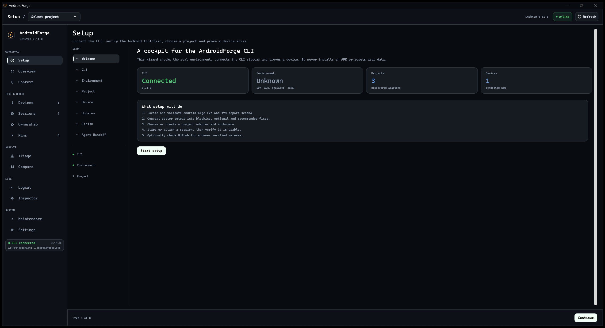 |
| Setup / Agent Handoff | 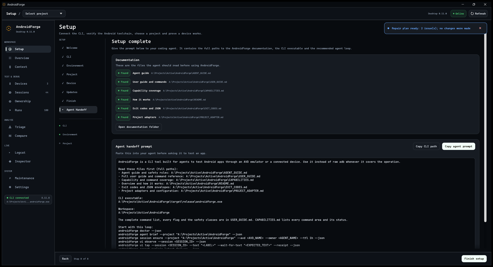 |
| Overview | 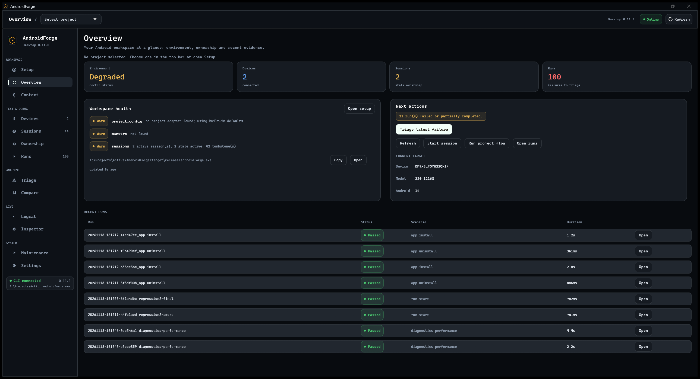 |
| Context | 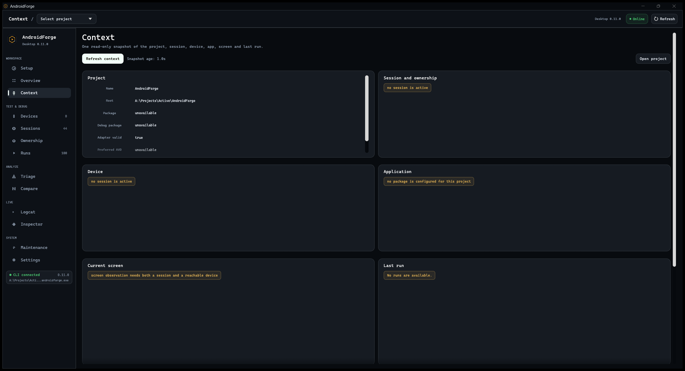 |
| Devices | 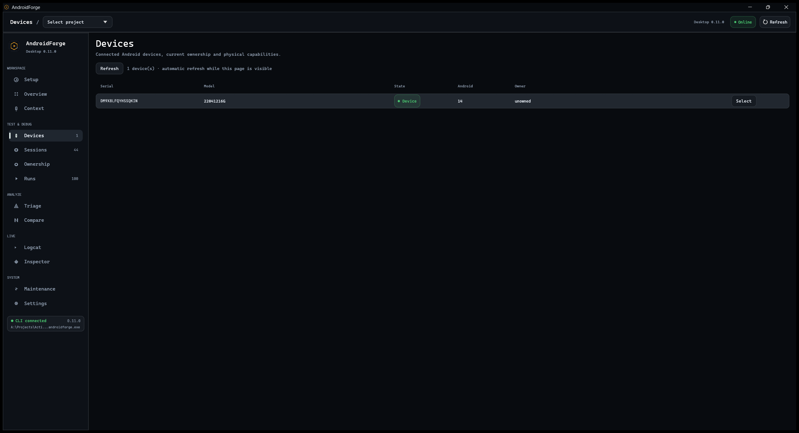 |
| Sessions | 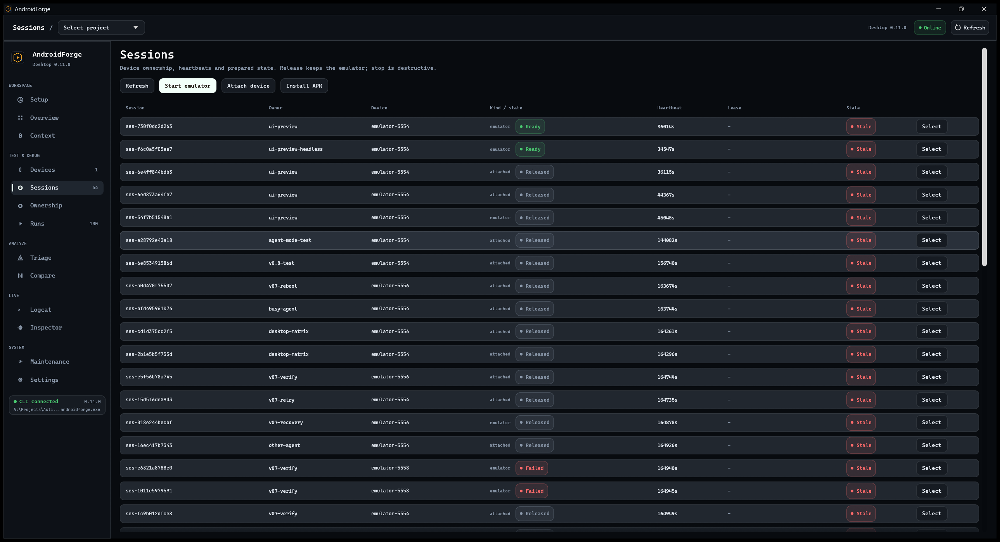 |
| Ownership | 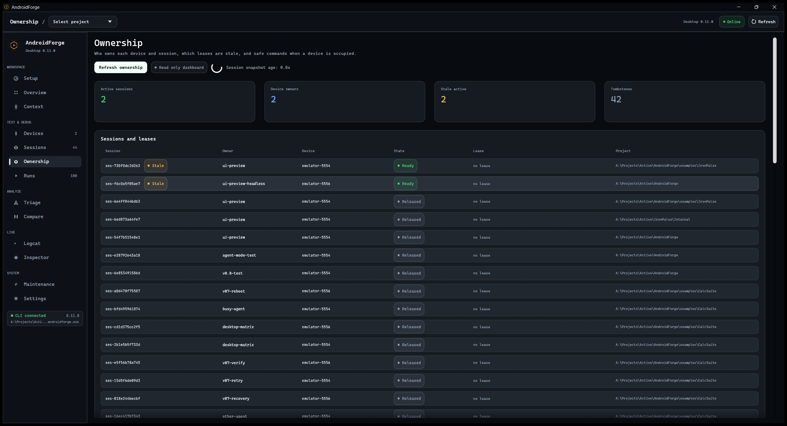 |
| Runs | 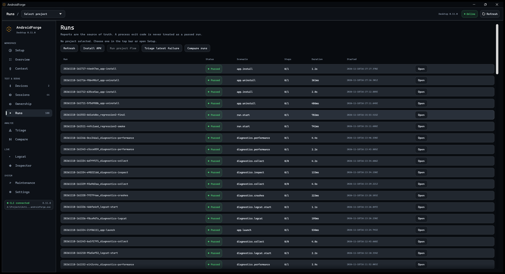 |
| Triage | 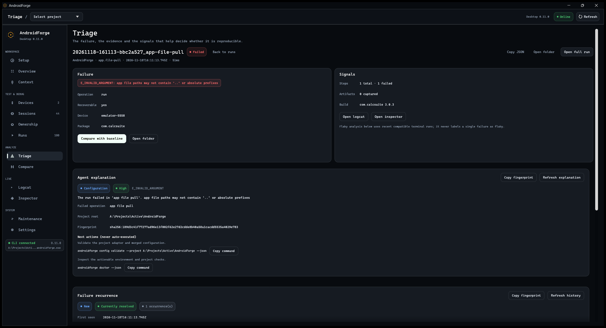 |
| Compare | 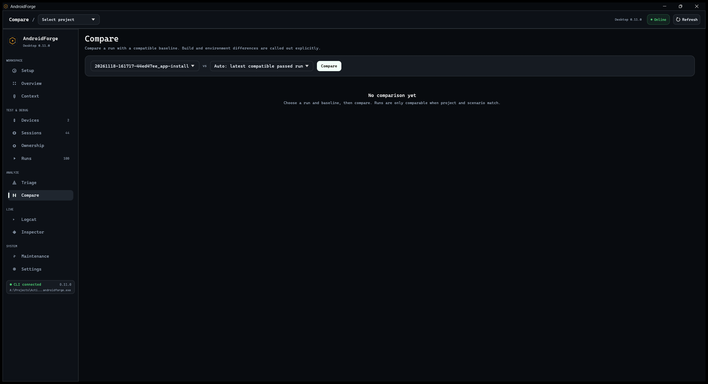 |
| Matrix | 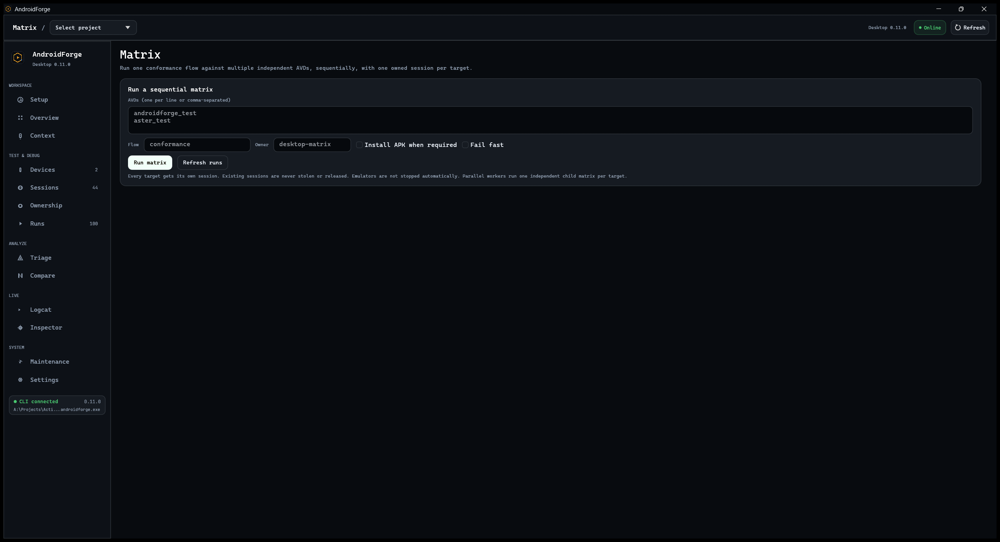 |
| Logcat | 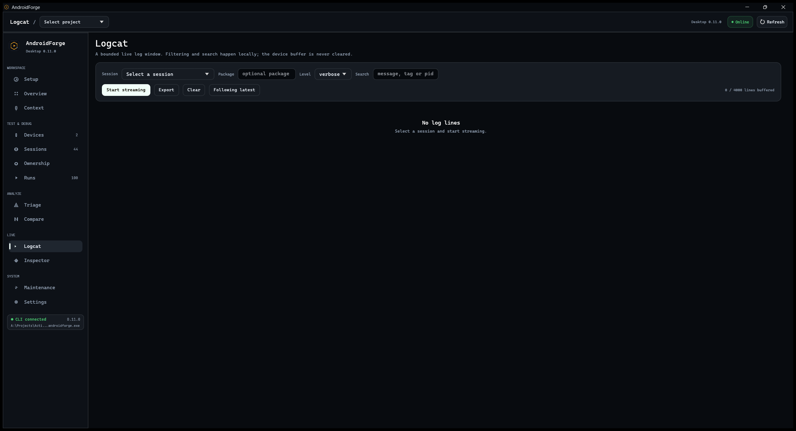 |
| Inspector | 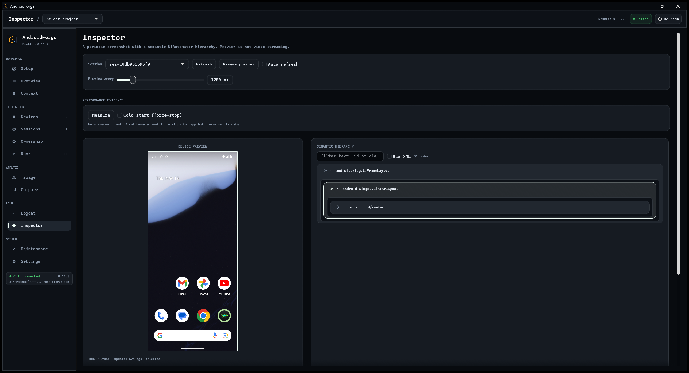 |
| Maintenance | 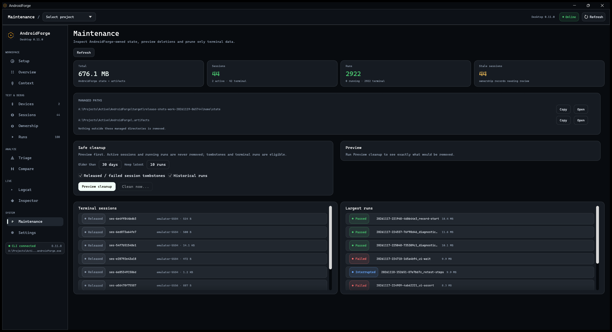 |
| Settings | 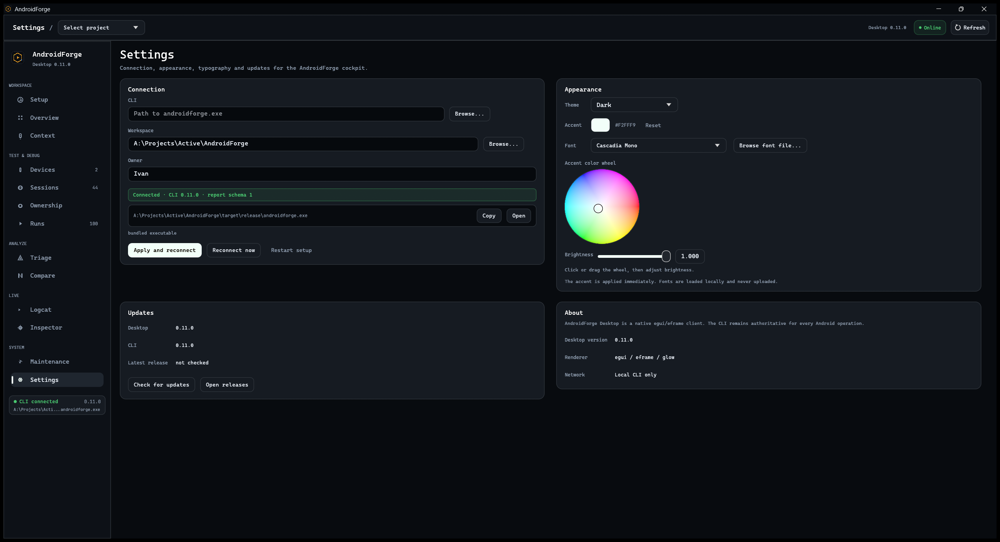 |
| Light mode | 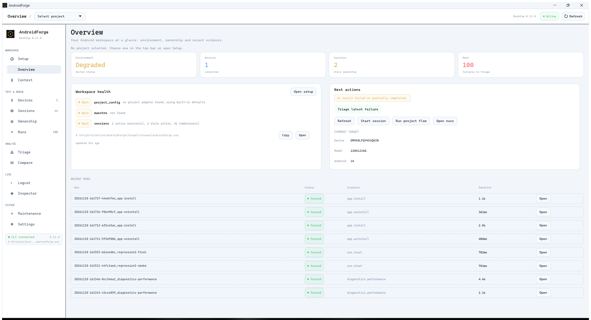 |

## Release assets

| Asset | Contents |
| --- | --- |
| `androidforge-cli-windows-x86_64.zip` | Standalone `androidforge.exe` for PATH and automation. |
| `androidforge-desktop-windows-x86_64.zip` | Portable `androidforge.exe` + `androidforge-desktop.exe`, `LICENSE`, `README.md`, `USER_GUIDE.md`, `CHANGELOG.md` and `PORTABLE.txt`. |
| `androidforge-windows-x86_64-setup.exe` | Per-user Windows installer with both executables, Start Menu shortcuts and uninstaller. User data outside the install directory is preserved on upgrade/uninstall. |
| `androidforge-screenshots-v0.11.0.zip` | 16 PNG screenshots of the updated desktop UI. |
| `SHA256SUMS.txt` | SHA-256 checksums for the CLI, portable desktop and installer assets. |

All binaries are intentionally unsigned. Windows SmartScreen may warn on first launch. Verify the
published SHA-256 checksums before running downloaded files.

## Compatibility and upgrade

- Workspace, CLI, desktop, installer and compatibility version are `0.11.0`.
- Report schema remains `1`; v0.10.0 reports remain readable.
- Existing selector, JSON envelope, exit codes and session ownership behavior are unchanged.
- Configuration lives outside the install directory and is preserved by the installer.
- Local-only `SPEC-v*.md` draft files are no longer tracked in the public repository; they remain on
  the developer machine and are ignored by `.gitignore`.
- The desktop must use a CLI on the same `0.11.0` version line; it refuses a mismatched CLI rather than
  guessing.
- The standalone CLI can be placed on `PATH`; the desktop searches beside itself, then configured
  paths, then development builds, then `PATH`.

## Validation

- `cargo test --workspace`: **335 passed / 0 failed / 0 ignored**, 27 test executables.
- `cargo fmt --all -- --check` and `cargo clippy --workspace --all-targets -- -D warnings`: clean.
- Desktop smoke: **14/14 pages PASS**, non-blank captures, correct breadcrumbs, seeded Sessions,
  Ownership and Runs data, no leftover processes.
- Setup Agent Handoff: clipboard prompt verified with all six full documentation paths, CLI executable,
  workspace, command loop and safety line; Step 1→8 footer progression verified.
- Setup animations: measured content fade/slide and step-rail highlight glide over roughly 320 ms.
- Recursive Inspector: live emulator test progressed **1 → 2 → 3 nested card levels → 1**; whole-row
  clicks and animated collapse verified; isolated emulator/session stopped and cleaned up.
- Light mode: selected sidebar item readable, settings unchanged.
- Topbar Refresh: 98×37 px vs 83×27 px Online pill; hover fill/border changed; UIA Invoke reset the
  workspace-health timer and issued the expected CLI refresh calls.
- CLI card: path right edge measured 12 px inside the card border; full path exposed by tooltip; the
  persistent console showed AndroidForge help and a live prompt.
- Screenshot gallery: 16 images captured from the v0.11.0 release build.

## Known limitations

- Physical devices, vendor ROM installs, Maestro, a real instrumentation package, snapshot restore and
  root-only time changes remain incompletely validated.
- Real Tesseract accuracy depends on the engine and installed language data.
- MCP is local stdio only; no HTTP/SSE transport is shipped.
- macOS and Linux hosts are not validated.
- The desktop is Windows-focused; binaries are unsigned.
- The screenshots contain local project paths and emulator labels. Review them before reusing in a
  different environment.

## Documentation

- [AGENT_GUIDE.md](../../AGENT_GUIDE.md) — agent operating model and safety classes.
- [USER_GUIDE.md](../../USER_GUIDE.md) — setup, devices, sessions, commands and troubleshooting.
- [CAPABILITIES.md](../../CAPABILITIES.md) — honest command coverage.
- [README.md](../../README.md) — overview and how it works.
- [EXIT_CODES.md](../../EXIT_CODES.md) — stable exit codes and JSON envelopes.
- [PROJECT_ADAPTER.md](../../PROJECT_ADAPTER.md) — project configuration and fixtures.
- [Screenshot gallery](../screenshots/v0.11.0/README.md).
- [VERIFICATION.md](../../VERIFICATION.md) — recorded validation and limitations.
